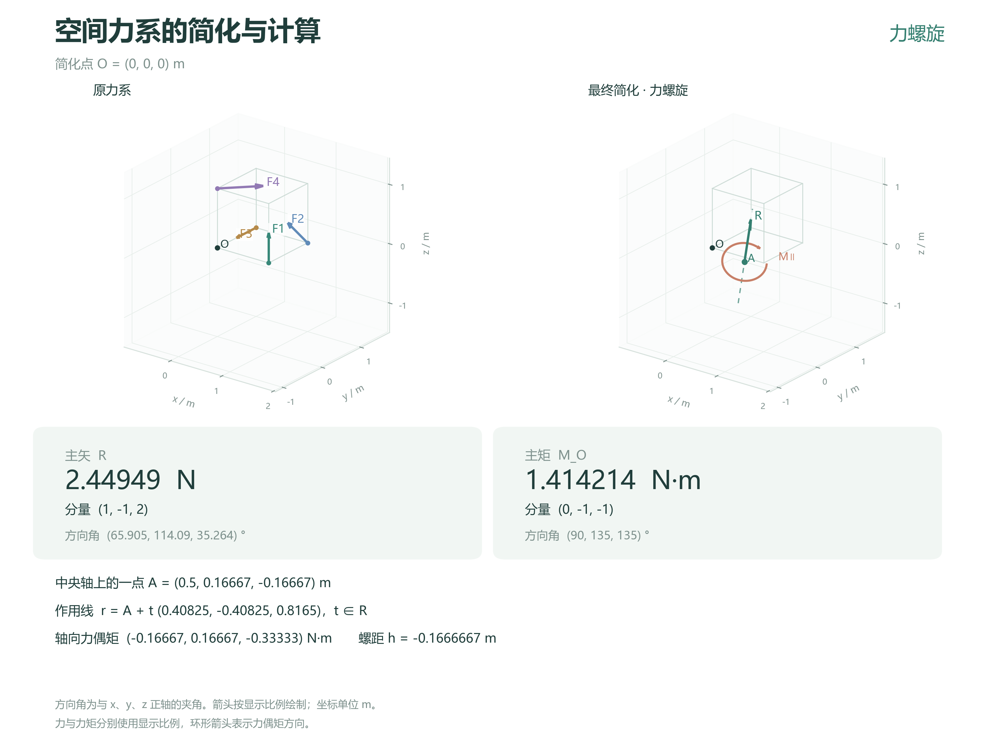

# 空间力系的简化与计算

本项目实现空间力系向指定点的简化。输入各力的大小、方向、作用点及简化点，得到主矢和主矩的分量、大小与方向，并判断力系最终简化为平衡力系、合力、力偶或力螺旋。对于合力给出作用线，对于力螺旋给出中央轴、轴向力偶矩和螺距。

计算采用右手直角坐标系，支持力的分量输入、大小与方向向量输入，以及独立力偶矩输入。统一使用 m、N 和 N·m。计算内核只依赖 Python 标准库，窗口和图像输出使用 Tkinter 与 Matplotlib。

窗口以载荷卡片输入数据，将主矢、主矩和最终简化结果集中显示，并排展示原力系与简化后的三维示意图。计算过程在右侧运行栏展开，结果可导出为高清 PNG 或矢量 SVG 图片。命令行与窗口使用同一套计算函数。

项目附有边长为 1 m 的立方体算例、结果图片和计算报告。[使用说明](docs/usage.md) 记录了运行方法与输入格式。

