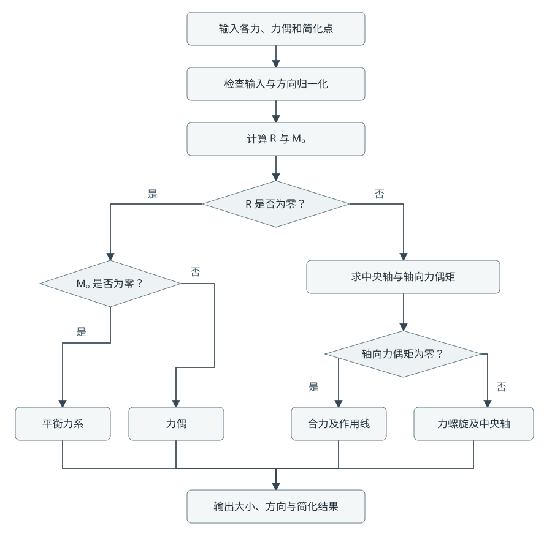
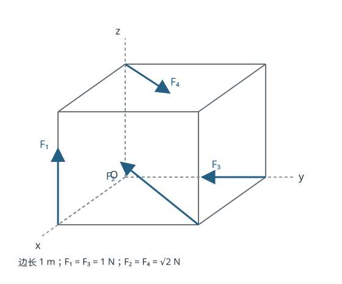

# 空间力系的简化与计算

工程力学课程编程作业

## 1. 题目与输入输出

编写程序，对任意空间力系向指定点进行简化，求主矢和主矩，并给出最终简化结果。若能简化为一个合力，需要确定合力作用线；若为力螺旋，需要确定中央轴及轴上保留的力偶矩。

输入包括各力的大小、方向、作用点和简化点。程序允许用分量直接输入力，也允许输入力的大小和任意非零方向向量。另外可以输入独立力偶矩。统一使用右手直角坐标系，长度用 m，力用 N，力矩用 N·m。

输出包括主矢、主矩的分量、大小、单位方向和方向角，以及最终简化类型、作用线或中央轴。零向量没有确定方向，此时输出“未定义”。

## 2. 计算原理

### 2.1 力的分量

若已知力的大小 F 和方向向量 d，则先将方向向量单位化：

$$
\mathbf F=F\frac{\mathbf d}{|\mathbf d|}.
$$

方向向量只表示比例。例如大小为 √2 N、方向向量为 (0,-1,1) 的力，其分量为 (0,-1,1) N。

### 2.2 向指定点简化

设简化点为 O，坐标为 o，第 i 个力的作用点坐标为 pᵢ。用作用点相对简化点的位置矢量计算力矩：

$$
\mathbf r_i=\mathbf p_i-\mathbf o,\qquad
\mathbf R=\sum_i\mathbf F_i,\qquad
\mathbf M_O=\sum_i(\mathbf r_i\times\mathbf F_i)+\sum_j\mathbf C_j.
$$

其中 Cⱼ 是独立力偶矩。叉积按右手法则，分量为：

$$
\mathbf r\times\mathbf F=
(yF_z-zF_y,\;zF_x-xF_z,\;xF_y-yF_x).
$$

换一个简化点 O′，主矢不变，主矩满足：

$$
\mathbf M_{O'}=\mathbf M_O-(\mathbf o'-\mathbf o)\times\mathbf R.
$$

这个关系也用于检查程序计算结果。

### 2.3 最终简化

| 条件 | 最终简化结果 |
| --- | --- |
| R = 0，Mₒ = 0 | 平衡力系 |
| R = 0，Mₒ ≠ 0 | 力偶，矩为 Mₒ，无唯一作用线 |
| R ≠ 0，R·Mₒ = 0 | 合力，需要确定作用线 |
| R ≠ 0，R·Mₒ ≠ 0 | 力螺旋，需要确定中央轴及同轴力偶 |

对于 R ≠ 0，先将主矩分成平行于主矢和垂直于主矢的两部分：

$$
h=\frac{\mathbf R\cdot\mathbf M_O}{|\mathbf R|^2},\qquad
\mathbf M_{\parallel}=h\mathbf R,\qquad
\mathbf M_{\perp}=\mathbf M_O-\mathbf M_{\parallel}.
$$

将主矢沿垂直方向移到 A 点，可抵消 M⊥，其中：

$$
\mathbf a=\mathbf o+\frac{\mathbf R\times\mathbf M_O}{|\mathbf R|^2}.
$$

中央轴方程为：

$$
\mathbf r=\mathbf a+t\frac{\mathbf R}{|\mathbf R|},\qquad t\in\mathbb R.
$$

A 是中央轴上距离所选简化点最近的一点，不一定在刚体内部。当 M∥ = 0 时，只剩沿这条作用线的合力；否则留下与 R 同轴的力偶，构成力螺旋。h 为有符号螺距，单位为 m；h < 0 表示保留的力偶矩与主矢反向。

等效关系可直接验算：

$$
(\mathbf a-\mathbf o)\times\mathbf R+\mathbf M_{\parallel}=\mathbf M_O.
$$

### 2.4 浮点数的判断

程序使用双精度浮点数，不能只用数值是否严格等于零来分类。力的判断阈值为 10⁻¹⁰ N 加 10⁻⁹ 倍各力大小之和；力矩阈值为 10⁻¹⁰ N·m 加 10⁻⁹ 倍各分力矩与独立力偶矩大小之和。判断是否为力螺旋时，比较主矩沿主矢方向的投影大小与力矩阈值。

输出保留计算得到的分量和实际使用的阈值。若输入量级接近容差，简化类型应理解为该精度下的结果。

## 3. 程序流程



程序分为三个部分：`mechanics.py` 负责向量计算和力系简化，`main.py` 负责命令行输入，`gui.py` 负责窗口输入和示意图。两种入口使用同一套计算函数，避免分别维护两套公式。

计算前检查向量是否为三个有限实数，方向向量是否为零，力的大小是否非负。输入不符合要求时给出提示，不继续使用错误数据。

## 4. 使用说明

运行环境为 Python 3.10 或以上版本。计算部分只使用标准库，窗口部分使用 Tkinter。

在 `force-system` 目录下运行 `python gui.py`。窗口默认加载课堂算例，表格显示每个力的作用点和分量。选中某一行后可以更新，输入新数据后点击“添加”可以增加载荷。修改简化点后点击“计算”，即可查看新的主矩和简化结果。

“力系示意”页显示各力和中央轴的固定斜投影。箭头使用共同的显示比例，示意图中的投影长度不等于力的真实大小，力偶矩在结果页中查看。JSON 打开和保存功能用于保存现场演示的输入。

命令行不带参数时逐项输入；`python main.py --example` 直接运行课堂算例；`python main.py --input examples/cube.json` 从文件读取；加上 `--output result.json` 可保存结果。

## 5. 课堂算例

### 5.1 建立坐标系

图示正方体边长 1 m，F₁ = F₃ = 1 N，F₂ = F₄ = √2 N。以图中的 O 点为原点，x 轴沿左侧底边指向前方，y 轴向右，z 轴向上。



按箭头方向，F₂ 沿前侧面对角线从右下指向左上，F₄ 沿顶面对角线从后左指向前右。选取各力作用线上的以下点：

| 力 | 作用点 pᵢ / m | 分量 Fᵢ / N | 对 O 点的矩 / N·m |
| --- | --- | --- | --- |
| F₁ | (1,0,0) | (0,0,1) | (0,-1,0) |
| F₂ | (1,1,0) | (0,-1,1) | (1,-1,-1) |
| F₃ | (0,1,0) | (0,-1,0) | (0,0,0) |
| F₄ | (0,0,1) | (1,1,0) | (-1,1,0) |

### 5.2 向 O 点简化

由各力分量相加，主矢为：

$$
\mathbf R=(0,0,1)+(0,-1,1)+(0,-1,0)+(1,1,0)
=(1,-1,2)\ \mathrm N.
$$

各分力矩相加，主矩为：

$$
\mathbf M_O=(0,-1,0)+(1,-1,-1)+(0,0,0)+(-1,1,0)
=(0,-1,-1)\ \mathrm{N\cdot m}.
$$

大小与方向如下：

| 量 | 大小 | 单位方向 | 与 x、y、z 正轴夹角 |
| --- | --- | --- | --- |
| R | √6 ≈ 2.4494897 N | (1,-1,2)/√6 | (65.905157°,114.094843°,35.264390°) |
| Mₒ | √2 ≈ 1.4142136 N·m | (0,-1,-1)/√2 | (90°,135°,135°) |

因此向 O 点简化的结果，是作用在 O 点的主矢 R 与矩为 Mₒ 的力偶。

### 5.3 最终简化

由于：

$$
\mathbf R\cdot\mathbf M_O=1\times0+(-1)\times(-1)+2\times(-1)=-1\ne0,
$$

力系不能简化为单独一个合力，最终为力螺旋。螺距和中央轴上的保留力偶矩为：

$$
h=-\frac{1}{6}\ \mathrm m,\qquad
\mathbf M_{\parallel}=\left(-\frac{1}{6},\frac{1}{6},-\frac{1}{3}\right)\ \mathrm{N\cdot m},
\qquad |\mathbf M_{\parallel}|=\frac{1}{\sqrt{6}}\ \mathrm{N\cdot m}.
$$

中央轴上距 O 最近的一点为：

$$
\mathbf a=\frac{(1,-1,2)\times(0,-1,-1)}{6}
=\left(\frac{1}{2},\frac{1}{6},-\frac{1}{6}\right)\ \mathrm m.
$$

中央轴的参数方程可以写为：

$$
x=\frac{1}{2}+s,\qquad y=\frac{1}{6}-s,\qquad z=-\frac{1}{6}+2s,\qquad s\in\mathbb R.
$$

这里 s 按 m 计，方向向量采用 (1,-1,2)；程序输出使用单位方向向量，只是参数尺度不同，表示同一条直线。

等效关系验算：

$$
\mathbf a\times\mathbf R=\left(\frac{1}{6},-\frac{7}{6},-\frac{2}{3}\right),\qquad
\mathbf a\times\mathbf R+\mathbf M_{\parallel}=(0,-1,-1)=\mathbf M_O.
$$

因此最终结果为：沿上述中央轴作用的力 R = (1,-1,2) N，加上轴向力偶矩 (-1/6,1/6,-1/3) N·m。两者方向相反。

### 5.4 程序输出

运行命令：

```bash
python main.py --example
```

主要结果：

```text
主矢 R = (1, -1, 2)
大小 = 2.4494897
主矩 M_O = (0, -1, -1)
大小 = 1.4142136
最终简化结果：力螺旋
中央轴上的一点 A = (0.5, 0.16666667, -0.16666667)
轴上保留的力偶矩 = (-0.16666667, 0.16666667, -0.33333333)
螺距 h = -0.16666667 m
```

完整输出保存在 `examples/cube_result.txt`。修改简化点后，主矩会改变；主矢、螺距和中央轴对应的空间直线保持不变。

## 6. 检查与适用范围

自动检查包含课堂算例和四种简化类型，并核对方向向量归一化、主矩换点公式、中央轴任一点的力矩重构及输入错误提示。在作业目录运行 `python -m unittest discover -s tests -v`，9 项检查通过。

本程序处理三维静力学集中力和力偶。平面力系是其特例；分布载荷需要先换算为等效集中力及力偶。程序的数值输出用于辅助计算，使用前仍需正确判断图中的力方向、作用点和单位。
